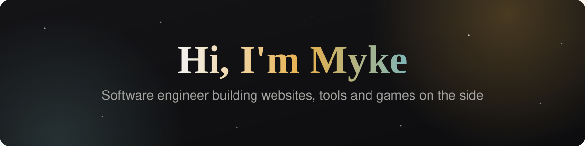
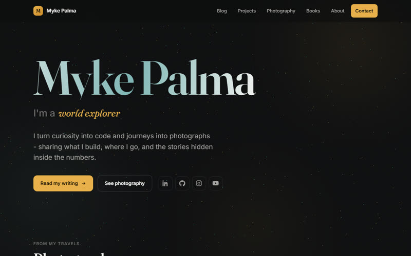

Software engineer at <b>Kaizen Gaming</b>, building things on the side: websites, tools and games. 
🚵 Mountain biking enthusiast · 🐶 Dog dad

---

## 🚀 Projects

### 📱 Apps

<table>
<tr>
<td width="280" valign="top">

 
<b><a href="https://myke.pt/projects/imginary.html">Imginary</a></b> 
Web app

A free SVG editor that runs in your browser.

<a href="https://github.com/MykePalma/imginary">Source code</a>
</td>
<td width="280" valign="top">

 
<b><a href="https://myke.pt/projects/orbit.html">Orbit</a></b> 
Windows app

A lightweight web browser built on Microsoft Edge WebView2.

<a href="https://github.com/MykePalma/OrbitBrowser">Source code</a>
</td>
<td width="280" valign="top">

 
<b><a href="https://myke.pt/projects/nodenotes.html">Node Notes</a></b> 
Windows app

Note-taking where every note is a node in a graph.

</td>
</tr>
</table>

### 🧩 Browser Extensions

<table>
<tr>
<td width="280" valign="top">

 
<b><a href="https://chromewebstore.google.com/detail/dark-reader-lite/angdjopchjfpeimemdedhfefocfchnfp">Dark Reader Lite</a></b> 
Chrome extension

Lightweight dark mode for the web, easy on the eyes at night.

</td>
</tr>
</table>

### 🌐 Websites

<table>
<tr>
<td width="280" valign="top">

 
<b><a href="https://myke.pt/">myke.pt</a></b> 
Personal site

Writing, photography, books and projects.

</td>
<td width="280" valign="top">

 
<b><a href="https://josepalmaeventos.pt/">José Palma Eventos</a></b> 
Event production

A site built around their own night-time event photography.

</td>
</tr>
</table>

### 🎲 Fun bits

<table>
<tr>
<td width="280" valign="top">

 
<b><a href="https://myke.pt/projects/randomimagegenerator.html">Random Image Generator</a></b> 
Generator

Generates cool and crazy images on demand.

<a href="https://github.com/MykePalma/RandomImageGenerator">Source code</a>
</td>
<td width="280" valign="top">

 
<b><a href="https://myke.pt/Apps/threejs/world/index.html">Three.js World</a></b> 
3D world

An interactive 3D world, right in the browser.

</td>
</tr>
</table>

---

## 💻 Tech Stack

<b>Languages &amp; Frameworks</b>

 

         

<b>Frontend &amp; Mobile</b>

 

         

<b>Backend &amp; Data</b>

 

         

<b>Cloud, DevOps &amp; Infra</b>

 

             

<b>Data Science &amp; ML</b>

 

     

<b>Tools &amp; Design</b>

 

         

<b>Other</b>

 

     

---

## 📊 GitHub Stats

---

